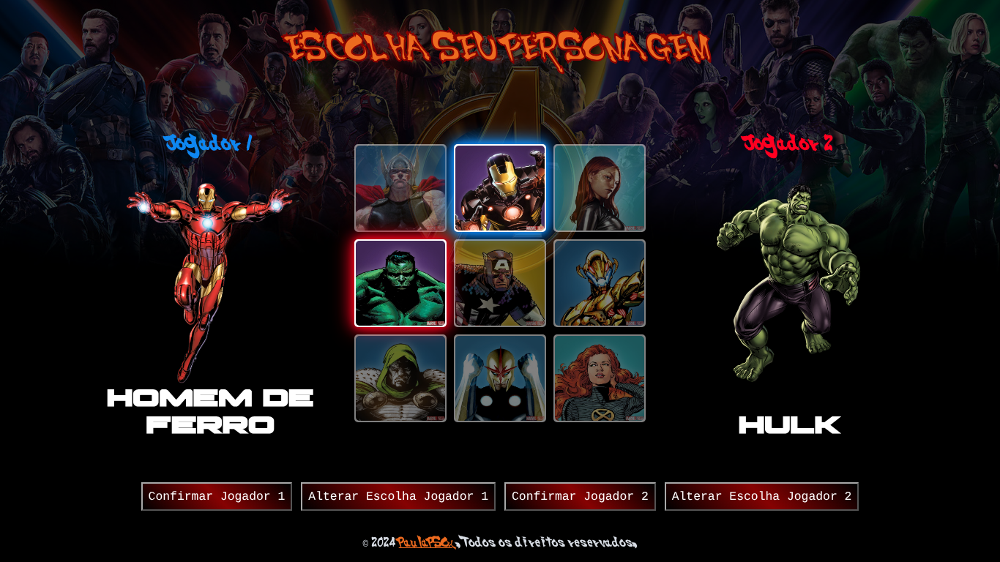
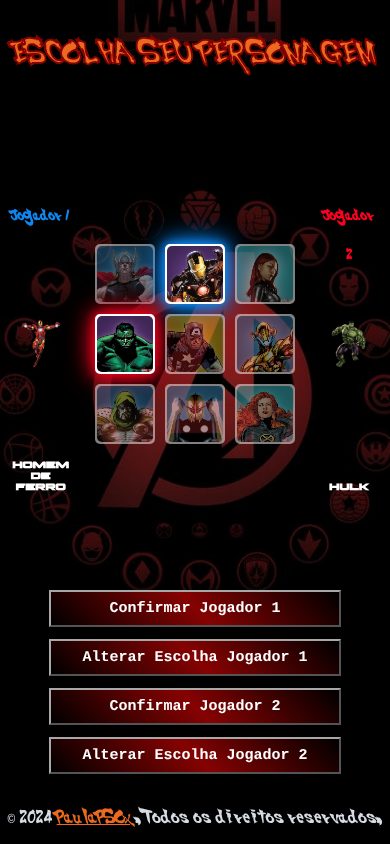
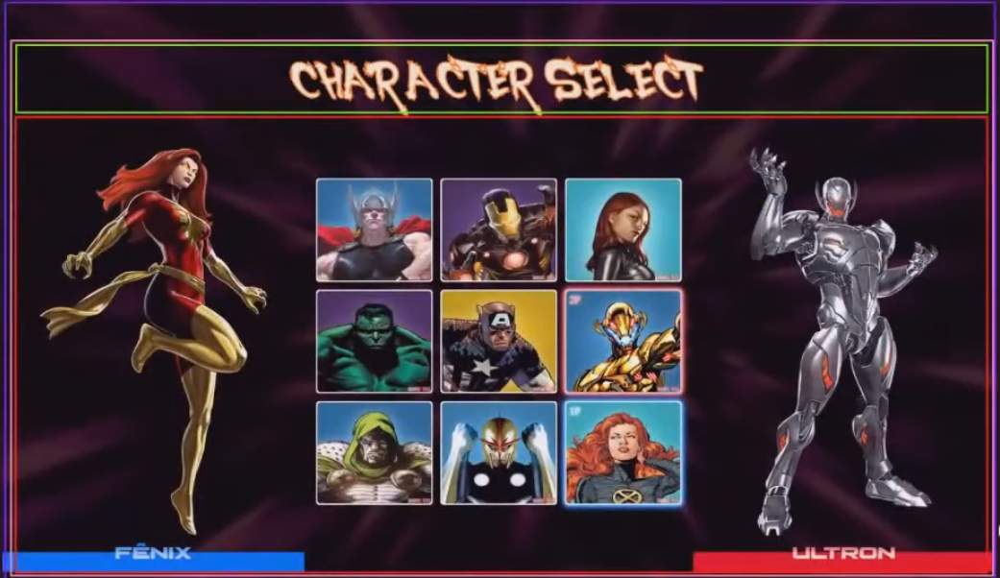
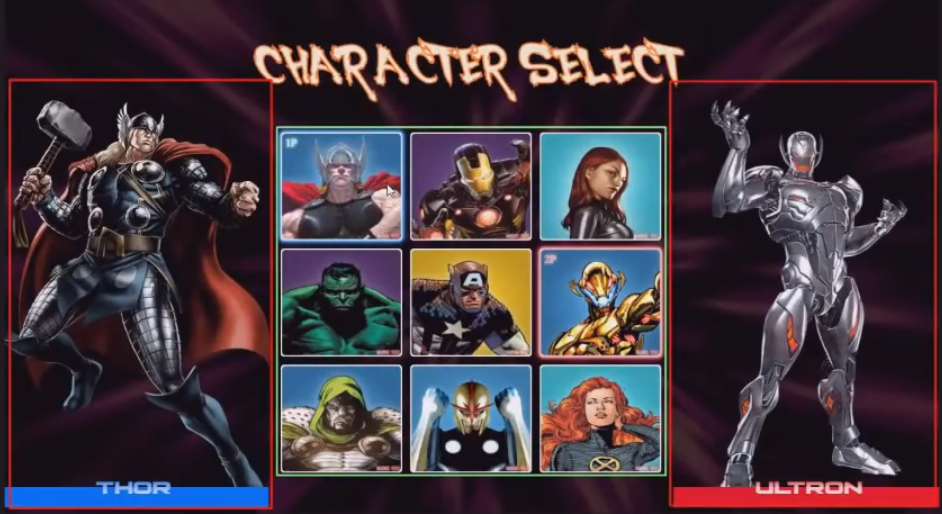

<div align="center">



<br><br>

# 🦸 MARVEL — SELEÇÃO DE PERSONAGENS

**Uma tela de seleção para dois jogadores, no estilo dos jogos de luta, com 9 heróis e vilões da Marvel.**<br>
HTML5 · CSS3 · JavaScript puro — sem frameworks, sem bibliotecas e sem etapa de build.

<p>
  
  
  
</p>

<p>
  <a href="https://paulapsox.github.io/marvel-selecao-de-personagem/index.html">
    
  </a>
  <a href="https://github.com/paulaPSOx/marvel-selecao-de-personagem">
    
  </a>
</p>

</div>

---

## ⚡ Em 30 segundos

| | |
| :-- | :-- |
| **O que é** | Uma página de seleção em que dois jogadores escolhem seus personagens, com visual inspirado em jogos de luta. |
| **Para quê** | Praticar manipulação do DOM, eventos, controle de estado e responsividade em um projeto completo e publicado. |
| **Destaque** | Lógica de dois jogadores com regras de escolha, confirmação e troca, sem repetir código para cada jogador. |
| **Stack** | HTML5, CSS3 (Flexbox, transições, animações e media queries), JavaScript (ES6+). |
| **Online** | [paulapsox.github.io/marvel-selecao-de-personagem](https://paulapsox.github.io/marvel-selecao-de-personagem/index.html) |

---

## 🎮 Veja em ação

> 💡 **Dica para quem for testar:** passe o mouse sobre os cards para ver o personagem aparecer ao lado, escolha dois heróis e confirme a escolha de cada jogador.

<table>
  <tr>
    <td width="68%" valign="top">
      
      <p align="center"><strong>💻 Computador</strong><br>Cards no centro e os personagens escolhidos nas laterais.</p>
    </td>
    <td width="32%" valign="top">
      
      <p align="center"><strong>📱 Celular</strong><br>Layout adaptado para telas pequenas.</p>
    </td>
  </tr>
</table>

---

## ⭐ Power-ups (funcionalidades)

### 🧑‍🤝‍🧑 Seleção para dois jogadores
- 9 personagens: Thor, Homem de Ferro, Viúva Negra, Hulk, Capitão América, Ultron, Doutor Doom, Nova e Fênix.
- A página abre com dois personagens sorteados, sempre diferentes entre si.
- Enquanto o jogador ainda não escolheu, passar o mouse em um card mostra o personagem grande ao lado, com o nome.
- O primeiro clique define o **Jogador 1** (brilho azul) e o segundo, o **Jogador 2** (brilho vermelho).
- Um jogador não pode escolher o personagem que o outro já escolheu.
- Quando os dois escolhem, os outros 7 cards ficam esmaecidos.

### ✅ Confirmar ou trocar
- Os botões só ficam ativos depois que o jogador escolhe um personagem.
- **Confirmar** trava a escolha com destaque amarelo e desativa os botões daquele jogador.
- **Alterar escolha** libera o jogador para escolher outro personagem.

### 🎨 Visual
- Duas fontes personalizadas carregadas com `@font-face`.
- Fundo com imagem em transparência e troca de fundo em telas menores.
- Cards que crescem levemente e ganham brilho animado ao passar o mouse.

### ♿ Acessibilidade
- Os cards podem ser escolhidos pelo teclado: **Tab** para navegar e **Enter** ou **Espaço** para escolher.
- Contorno amarelo visível no card ou botão em foco.
- O texto alternativo (`alt`) das imagens dos jogadores acompanha o personagem escolhido.

---

## 🔧 Por dentro do código

Algumas decisões que tomei durante o desenvolvimento:

| Tema | Como foi resolvido |
| :-- | :-- |
| **Dados no HTML** | Cada card é um `<li>` com `id` e `data-name`. O `id` monta o caminho da imagem grande (`./src/imagens/${id}.png`) e o `data-name` guarda o nome de exibição, com acento (ex.: "Viúva Negra"). |
| **Sorteio inicial** | `randomizarPersonagens()` sorteia dois índices com `Math.random()` e repete o segundo sorteio até ele ser diferente do primeiro. |
| **Código reutilizável** | `aplicarHover`, `confirmarJogador` e `alterarJogador` recebem como parâmetros a imagem, o nome, os botões e a classe de cor de cada jogador. Assim, as mesmas funções atendem os dois jogadores. |
| **Estado visual por classes** | O JavaScript só adiciona e remove classes com `classList` (`c-glowing-blue`, `c-glowing-red`, `indisponivel`, `hover-yellow`). Toda a aparência fica no CSS. |
| **Atualização da tela** | A função `atualizarJogador` troca imagem, texto alternativo e nome do personagem em um só lugar, usada na seleção, no hover e no sorteio inicial. |
| **Teclado** | Os cards têm `tabindex="0"` e `role="button"`. Um evento `keydown` aciona o mesmo clique quando o jogador aperta Enter ou Espaço, sem duplicar a lógica. |
| **Botões** | O atributo `disabled` impede ações fora de hora, como confirmar antes de escolher. |
| **Responsividade** | Media queries em 1200, 985, 585 e 485 px adaptam o layout. Flexbox organiza a tela e uma imagem de fundo diferente entra nas telas menores. |

### 🎯 Destaque: o estado da seleção

| Variável | Papel na tela |
| :-- | :-- |
| `jogador1Selecionado` | Indica se o Jogador 1 já escolheu. Define quem recebe o próximo clique. |
| `jogador2Selecionado` | Indica se o Jogador 2 já escolheu. |
| `jogador1Personagem` | Guarda o card escolhido (ou sorteado) do Jogador 1. |
| `jogador2Personagem` | Guarda o card escolhido (ou sorteado) do Jogador 2. |

Quem recebe o clique depende dessas variáveis: se o Jogador 1 ainda não escolheu, o clique é dele. Depois, o próximo clique vai para o Jogador 2.

---

## 🧱 Blocos de construção (tecnologias)

<table>
  <tr>
    <td align="center" width="33%">
      <br>
      <strong>HTML5</strong><br>
      <sub>Estrutura semântica da página.</sub>
    </td>
    <td align="center" width="33%">
      <br>
      <strong>CSS3</strong><br>
      <sub>Layout, efeitos e responsividade.</sub>
    </td>
    <td align="center" width="33%">
      <br>
      <strong>JavaScript</strong><br>
      <sub>Lógica dos jogadores, DOM e eventos.</sub>
    </td>
  </tr>
</table>

**Complementos:** fontes personalizadas locais (`@font-face`) · [GitHub Pages](https://pages.github.com/) (hospedagem). Não há bibliotecas externas.

---

## 🗂️ Estrutura do projeto

```text
marvel-selecao-de-personagem/
├── index.html            # Página única
├── img-marvel/           # Prints e imagens de referência (usadas neste README)
├── src/
│   ├── css/              # style.css, animacoes.css e fontes.css
│   ├── fontes/           # fontes personalizadas
│   ├── imagens/          # cards (.jpg), personagens grandes (.png) e fundos
│   └── js/               # script.js
├── LICENSE
└── README.md
```

---

## 🚀 Como rodar

Não há dependências nem etapa de build. Escolha uma das opções:

**Opção 1 — Acessar online:** [abrir no GitHub Pages](https://paulapsox.github.io/marvel-selecao-de-personagem/index.html).

**Opção 2 — Baixar o ZIP:** clique em **Code → Download ZIP** neste repositório, extraia e abra o `index.html` no navegador.

**Opção 3 — Clonar com Git:**

```bash
git clone https://github.com/paulaPSOx/marvel-selecao-de-personagem.git
cd marvel-selecao-de-personagem
```

Depois, abra o `index.html` no navegador. Se usar o VS Code, a extensão **Live Server** também funciona.

> Mantenha a pasta `src/` no lugar original para as imagens e as fontes carregarem.

---

## 📚 O que este projeto me ensinou

- Estruturar uma página com HTML semântico e atributos `data-*`.
- Manipular o DOM e reagir a eventos de `mouseover`, `mouseout` e `click`.
- Controlar o estado da interface com variáveis e classes CSS.
- Escrever funções reutilizáveis com parâmetros, em vez de repetir código para cada jogador.
- Aplicar acessibilidade básica: navegação por teclado, foco visível e texto alternativo dinâmico.
- Usar fontes personalizadas com `@font-face`.
- Criar layouts com Flexbox e adaptá-los com media queries.
- Publicar um projeto com GitHub Pages.

---

## 🏁 Próximas fases

Melhorias que quero fazer, e que **ainda não estão implementadas**:

- [ ] Limpar a imagem do painel do jogador quando ele usa "Alterar escolha" (hoje só o nome é apagado).
- [ ] Criar uma próxima etapa depois que os dois jogadores confirmam, com opção de reiniciar a seleção.
- [ ] Otimizar o tamanho das imagens para a página carregar mais rápido.
- [ ] Adicionar mais personagens.

---

## 🎨 Inspiração e créditos

O ponto de partida foi um layout de referência do desafio, no estilo das telas de seleção de jogos de luta:

<table>
  <tr>
    <td width="50%">
      
    </td>
    <td width="50%">
      
    </td>
  </tr>
</table>

Projeto desenvolvido na **Mapa Dev Week**, a partir de desafios práticos das comunidades [**Dev Em Dobro**](https://github.com/devemdobro) e **Guild Dev Em Dobro**. Obrigada pelo conteúdo e pela oportunidade de praticar.

---

## 📄 Licença e aviso

Código disponibilizado sob a licença **MIT**. Veja o arquivo [`LICENSE`](LICENSE).

Projeto independente, feito para estudo e portfólio. Não possui vínculo, patrocínio ou aprovação da Marvel, da Disney ou de qualquer outra detentora de direitos. Personagens, nomes e imagens pertencem aos seus respectivos titulares. As fontes utilizadas têm licenças próprias de seus autores.

---

<div align="center">

## 👩‍💻 Feito por Paula Oliveira

Desenvolvedora full stack em formação, com foco atual em front-end.<br>
Este projeto marca uma etapa da minha evolução: da prática dos fundamentos à construção de algo completo, interativo e no ar.

<p>
  <a href="https://github.com/paulaPSOx">
    
  </a>
  <a href="https://www.linkedin.com/in/oliveiraspaula/">
    
  </a>
</p>

**Gostou? Deixe uma ⭐ no repositório. É o meu power-up favorito.** 🦸

</div>
